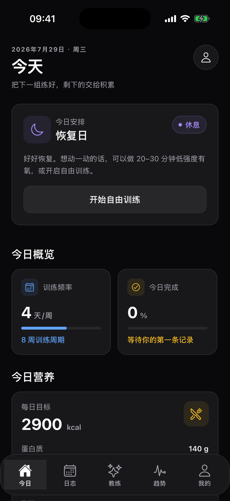
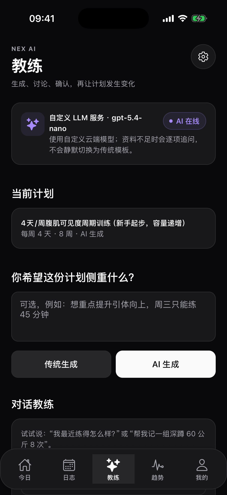
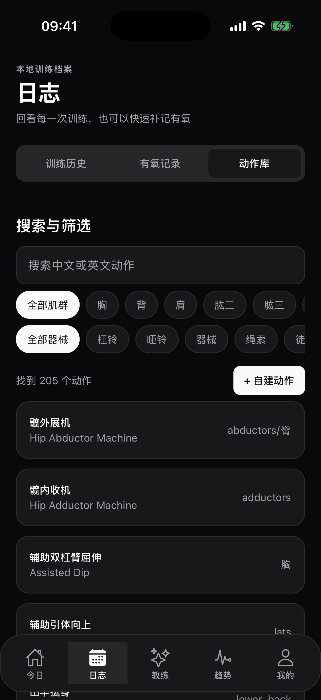

# Nexset

Nexset 是一个本地优先的 Expo / React Native 健身计划与训练记录应用，面向 Web、iOS 和 Android。档案、计划、训练、有氧和身体数据默认保存在本地 SQLite；AI 只生成需要用户确认的草案，不会静默修改数据。

> 项目处于早期开发阶段。核心流程已有自动化测试，Apple Watch、HealthKit、Widget、Live Activity 等原生能力仍需要开发构建和真机验证。Nexset 不提供医疗诊断。

## 产品预览

| 今日训练 | AI 教练 | 动作库 |
| :---: | :---: | :---: |
|  |  |  |

<p align="center"><sub>截图来自 iOS Simulator；界面可能随项目迭代调整。</sub></p>

## 功能概览

- 引导问卷、本地安全模板计划，以及能够按需追问的 AI 计划生成。
- 今日训练、逐组记录、休息计时、训练小结和历史记录。
- 有氧、身体数据、动作库、自定义动作和训练统计。
- 近 7 天偏差分析、计划差异预览，以及需要确认的每日调整建议。
- 对话教练的本地意图路由、数据查询、动作要点和确认式记组。
- OpenAI-compatible `/chat/completions` 与 Anthropic `/v1/messages` 自定义模型服务。
- iOS 上优先尝试 Apple Intelligence，能力不可用或本地校验失败时按策略回退。
- Apple Watch 手动记组与设备端自动计数 Beta、HealthKit、Widget、Live Activity、App Intents 和触感反馈。

WebDAV 当前仅包含配置与连接检测基础设施，完整跨端同步仍在开发中，界面不会将其标记为已完成。

## 技术与隐私原则

- **Local first**：训练数据默认留在设备本地。
- **User controlled AI**：用户自行选择模型服务并配置凭据。
- **Validate before apply**：AI 结果必须通过结构、动作、伤病、重量和营养范围校验。
- **Confirm mutations**：计划和训练变更先展示差异，再由用户确认。
- **Graceful fallback**：AI 或平台能力不可用时，不影响本地训练记录。

调用自定义云端 AI 时，完成请求所需的档案和训练摘要可能会发送给服务商。移动端凭据存入系统安全存储；Web 端保护能力较弱，请使用限额 Key，避免在公共设备保存。公网 WebDAV 必须优先使用 HTTPS；HTTP 会明文传输凭据和数据，只适合可信内网。

## 快速开始

要求 Node.js 22.13+（22.x）、24.3+ 或 25+；React Native 0.86 不支持 Node.js 23。仓库的 `.nvmrc` 固定使用已验证的 24.3.0。Web 开发只需 Node.js 与 npm；原生开发还需要对应平台工具链。

```bash
npm ci
npm run web
```

运行移动端开发构建：

```bash
npm run ios
npm run android
```

项目包含自定义原生模块，完整 Apple 能力不能在 Expo Go 中验证。签名、标识符、HealthKit、Widget 和 Watch 配置见 [Apple 生态接入说明](docs/apple-ecosystem.md)。

## AI 配置

在「我的 → AI 设置」中填写：

1. OpenAI 兼容或 Anthropic 协议；
2. HTTPS Base URL；
3. 服务商提供的模型 ID；
4. API Key；
5. 点击「测试连接并检测能力」。

OpenAI 兼容地址会自动追加 `/chat/completions`，Anthropic 地址会自动追加 `/messages`。生成计划时会优先尝试支持的设备端能力；只有任务策略允许且需要回退时，才会请求已配置的云端服务。

## 开发检查

```bash
npm run check
```

该命令依次运行 TypeScript 检查、ESLint 和单元测试。计划、调整和意图路由还有独立的本地评测：

```bash
npm run eval:plan
npm run eval:adjust
npm run eval:intent
```

`eval:plan` 会生成 `eval/latest-report.md`，覆盖合法与危险样本。真实模型批量评测需要额外 API Key 和费用确认，本地报告不会伪造这一部分结果。

## 项目结构

```text
src/app/                 Expo Router 页面
src/ai/                  AI 配置、Runtime 与计划/调整 Agent
src/intelligence/        平台无关能力契约、路由与 Provider
src/components/          可复用界面组件
src/data/                内置动作库与器械映射
src/db/                  SQLite Schema、迁移与 repositories
src/lib/                 计划 Schema、模板、营养公式与硬校验
src/store/               Zustand 应用状态
src/sync/                WebDAV 配置、地址与错误处理
src/platform/apple/      HealthKit、Watch、实时活动与系统桥接
widgets/                 主屏组件、锁屏实时活动与灵动岛布局
targets/watch/           Apple Watch SwiftUI 应用
native/                  Apple Intelligence / App Intent 原生桥接
eval/                    本地评测脚本与报告
```

## 参与项目

提交代码前请阅读 [贡献指南](CONTRIBUTING.md)；安全问题请按 [安全政策](SECURITY.md) 私下报告。

## 许可证

本项目使用 [MIT License](LICENSE)。
